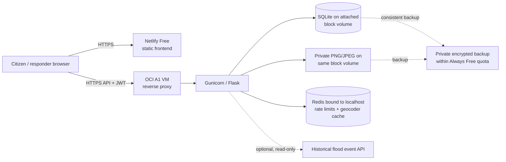

# ResQNet free-only deployment feasibility plan

> Subsequent preparation selected Render Free + Supabase Free for review. See
> [DEPLOYMENT.md](DEPLOYMENT.md) for the current configuration and remaining
> validation gates. This document retains the earlier OCI feasibility audit.

Audit date: 21 October 2026. This is a plan, not deployment approval or a claim
of production readiness. No cloud account, resource, real database, secret, or
satellite output was accessed or changed. Provider limits below are from official
documentation checked on this date; verify the actual account and region before
provisioning. Keep the existing local demonstration available while evaluating
hosting.

## Recommendation: conditional, small-scale preview

Use **Netlify Free** for the static `frontend/` and **one OCI Always Free Ampere A1
VM** for Flask/Gunicorn, a local-only Redis service, and a reverse proxy with
HTTPS. Put SQLite and private images on an **attached OCI Always Free block
volume**, outside the web root. Keep optional weather and historical flood
upstreams disabled initially. This preserves the current SQLite and private-file
contracts and avoids a database or object-storage rewrite. It is suitable only
for a low-traffic, supervised preview after the gates below pass. A single free
VM, free-provider capacity, and absent uptime guarantees are not suitable as the
sole operational emergency service.

The optional flood API is not needed for SOS operation. If enabled later, host
its existing processed artifacts read-only, behind an authenticated or bounded
proxy, only after measuring size/CPU/egress and reviewing provenance. Never copy
or rerun the satellite pipeline as part of deployment. Its candidate polygons
and exposure remain historical and unvalidated.

## Existing application contract

| Area | Current code and consequence |
| --- | --- |
| Startup | `backend/wsgi.py` calls `create_app()`; `render.yaml` uses one Gunicorn worker and four threads. Linux/ARM startup has not been run. `/health` exists. |
| Database | `backend/config.py`, `backend/database.py`, `backend/security.py`: production accepts **mounted, absolute-path SQLite only**; `create_all()` initializes an empty schema, but there is no migration system. A PostgreSQL URL in a comment/example is not implemented production support. |
| Images | `backend/private_uploads.py` and `backend/sos_lifecycle.py` store private incident/proof PNG/JPEG under `UPLOAD_FOLDER`; access-controlled Flask routes serve them. A public static directory or disposable filesystem would lose or expose evidence. |
| Redis | `backend/rate_limits.py` requires a reachable Redis-compatible store at production startup and fails closed if it fails. `backend/routes/geocode.py` also uses it for shared rate/caching. Bind local Redis to loopback; never publish its port. |
| Secrets / CORS | `backend/security.py` requires independent persistent `SECRET_KEY` and `JWT_SECRET_KEY`, production mode, demo seeding/debug off, exact HTTPS `CORS_ORIGINS`, private upload/database paths and a reviewed proxy hop count. Do not seed demo credentials. |
| Frontend | `frontend/js/api.js` still defaults hosted traffic to an earlier Render URL. `netlify.toml` publishes `frontend/`, with static security headers; Netlify environment variables do **not** rewrite this JavaScript. Configure one reviewed HTTPS API origin before release. |
| Render proposal | `render.yaml` explicitly selects paid `starter` and a paid disk. It is **review-only** under the free-only rule; do not apply it or merely change `plan` to `free`. |
| Dependencies | `backend/requirements.txt` pins Flask, Pillow, NumPy, Gunicorn, SQLAlchemy, JWT, bcrypt and Flask-Limiter/Redis. Exact Python-version and Linux ARM wheel/build compatibility must be tested on an isolated A1 instance. |

## Free options and practical limits

| Need | Recommended / alternative | Free limit, sleep, retention, account and compatibility |
| --- | --- | --- |
| Static frontend | **Netlify Free**; Cloudflare Pages is an alternative | New Netlify credit-based Free offers **300 credits/month, hard capped**, $0 subscription; a site may be limited when credits run out. Check whether this account instead has a legacy plan and verify actual bandwidth/build allowance in its dashboard. Existing `netlify.toml` needs no hosting rewrite. [Netlify pricing](https://docs.netlify.com/manage/accounts-and-billing/billing/billing-for-credit-based-plans/credit-based-pricing-plans/). Cloudflare Pages Free lists **500 builds/month** and per-asset/site limits, but switching adds release work. [Pages limits](https://developers.cloudflare.com/pages/platform/limits/). |
| Python backend | **OCI Always Free A1 VM**; Render Free is an unsuitable direct replacement | OCI A1 allowance is **1,500 OCPU-hours + 9,000 GB-hours/month** (equivalent to 2 OCPU/12 GB for an Always Free tenancy), in the home region only. Capacity can be unavailable; low-use instances can be reclaimed. There is no free uptime guarantee. OCI usually requires phone and credit card at signup; trial credits are separate, temporary and excluded here. [OCI Always Free](https://docs.oracle.com/en-us/iaas/Content/FreeTier/freetier_topic-Always_Free_Resources.htm), [OCI Free Tier](https://docs.oracle.com/en-us/iaas/Content/FreeTier/freetier.htm). Render Free sleeps after 15 minutes, takes roughly a minute to wake, and loses local files on restart/spin-down. [Render Free](https://render.com/docs/free). |
| Durable database | **SQLite on OCI attached block volume** | OCI includes **200 GB combined boot + block volume** in the home region; a 50 GB boot volume counts against it. Allocate a bounded separate data volume and verify mount-before-service. SQLite is a single-writer design; test realistic concurrency. Existing rows require a deliberate, consistent migration/backup plan, not `create_all()` alone. OCI includes up to **five** free volume backups, but a raw snapshot alone is not an application-consistent backup. [OCI storage allowance](https://docs.oracle.com/en-us/iaas/Content/FreeTier/freetier_topic-Always_Free_Resources.htm). Render Free Postgres expires after **30 days**, has **1 GB**, and no backups, so it is not durable for this purpose. [Render Free](https://render.com/docs/free). |
| Private image storage | **Same OCI block volume**, private Flask routes | No object-storage adapter required; keep strict filesystem permissions and no direct static URLs. Track total images against volume size. An encrypted off-VM backup is still required. OCI Always Free Object Storage offers **20 GB** and **50,000 API requests/month** in Always Free-only state; do not treat trial overage as permanent. [OCI object storage](https://docs.oracle.com/en-us/iaas/Content/FreeTier/freetier_topic-Always_Free_Resources.htm). Cloudflare R2's **10 GB-month** standard free allowance is an alternative, but its billing/overage terms and a new private-object adapter need review. [R2 pricing](https://developers.cloudflare.com/r2/pricing/). |
| Shared rate limiting | **Redis on the same VM**, loopback only | Shared across the one Gunicorn instance/workers; resource use fits only after measurement. Failure intentionally blocks limited requests. This is a single failure domain, not highly available. Upstash Free (alternative) lists **256 MB, 500K commands/month and 10 GB bandwidth**; protocol/TLS and real command usage would need testing. [Upstash pricing](https://upstash.com/pricing/redis), [protocol compatibility](https://upstash.com/docs/redis/overall/compatibility). |
| Optional flood artifact service | **Disabled for first release** | Could run read-only on the same A1 VM if verified artifacts fit the remaining disk/RAM/egress and are legally publishable. Its CPU and network load must not impair SOS. A separate free VM or object service creates more limits and operational complexity. |
| Network / HTTPS | **HTTPS API hostname and free certificate** | OCI lists **10 TB/month outbound** for Always Free; verify the actual tenant, firewall and usage dashboard. [OCI allowance](https://docs.oracle.com/en-us/iaas/Content/FreeTier/freetier_topic-Always_Free_Resources.htm). Let's Encrypt certificates are free, but require control of a stable DNS name and working automated renewal; a no-cost, reliable hostname has **not** been established. [Let's Encrypt](https://letsencrypt.org/). Mixed HTTP API content is unacceptable from the HTTPS frontend. |

An alternate Render Free + Neon Free Postgres + private object store + Upstash
design requires a reviewed DB driver/migration, private image storage adapter,
new backup plan and provider-quota monitoring; Render cold starts remain. Neon
currently advertises 1 GB/project and 100 CU-hours/month on Free, with only a
limited instant-restore window; this is not a tested migration path for the
current SQLite-only production guard. [Neon announcement](https://neon.com/blog/neon-free-plan-1-gb-per-project), [Render Free](https://render.com/docs/free).
Google Cloud's Always Free e2-micro has only 1 GB/month outbound and 30 GB disk
in specified US regions, so it is a poor fit for an India-facing image/map API.
[Google Cloud Free Program](https://docs.cloud.google.com/free/docs/free-cloud-features).

## Blockers and required changes before a release

1. **Account/capacity:** confirm OCI home-region A1 capacity, Always Free labels,
   an account that cannot silently create billable resources, actual Netlify
   plan/limits, and a stable free HTTPS hostname. A1 shortage or no hostname
   blocks this architecture. No trial credits or paid upgrades are part of it.
2. **Runtime:** on isolated Linux ARM, confirm pinned dependencies install and
   Gunicorn serves `/health` and the focused API/browser suites. Size CPU/RAM,
   upload disk growth, Redis usage and 10 MB upload cap at anticipated traffic.
3. **Persistence:** provision a separate Always Free data volume with filesystem
   permissions; verify the mount exists **before** Flask starts. Current
   `backend/security.py` checks an actual mount specifically on Render, so OCI
   needs a deployment-level mount assertion (for example, systemd mount
   dependency/preflight) before any service can write SQLite/uploads. Do not
   allow fallback writes onto ephemeral/boot storage.
4. **Backups and retention:** define encrypted, access-limited, consistent SQLite
   and image backups on a separate failure domain, stay within Object Storage
   and five-snapshot limits, monitor capacity, and perform a restore test.
   Decide retention/deletion for sensitive SOS/contact/proof records. Block
   public use until recovery is demonstrated; VM-local copies alone are not a
   backup. No existing real database should be migrated during feasibility work.
5. **Security/network:** put Gunicorn/Redis behind a TLS reverse proxy; expose
   only necessary ports, restrict SSH, run under an unprivileged account, keep
   secret files out of Git, and verify forwarded client IP before setting
   `TRUSTED_PROXY_HOPS`. Check private image authorization and no public upload
   path after release. Verify actual browser origin and exact CORS allowlist.
6. **Static configuration:** change the hosted default in `frontend/js/api.js`
   to the reviewed HTTPS API origin (or add a safe build-time config), then
   inspect every bundle/HTML reference. The existing Render hostname must not
   remain the production default. `render.yaml` remains unused; a minimal OCI
   service/proxy deployment specification would be needed after approval.
7. **Operations:** free services can be unavailable, throttled or reclaimed.
   Set usage and failure alerts, document a human fallback for emergencies,
   and avoid implying official disaster monitoring or guaranteed dispatch.
   Review OSM/Nominatim identification, quotas and third-party weather behavior.

## Environment/configuration inventory (names only)

Required backend: `APP_ENV`, `SECRET_KEY`, `JWT_SECRET_KEY`, `DATABASE_URL`,
`PERSISTENT_STORAGE_PATH`, `UPLOAD_FOLDER`, `RATELIMIT_STORAGE_URI`,
`CORS_ORIGINS`, `FLASK_DEBUG`, `SEED_DEMO_DATA`, `TRUSTED_PROXY_HOPS`.
`ADMIN_SECRET_CODE` is required only if production admin enrollment is intended;
otherwise leave enrollment disabled and use a reviewed bootstrap process.
Production values must be generated privately and persisted across restarts.
The frontend needs a reviewed `RESQNET_API_BASE` delivery/build setting or a
reviewed static `frontend/js/api.js` default, plus its exact Netlify HTTPS origin.
Optional: `OPENWEATHER_API_KEY`, `FLOOD_API_BASE_URL`,
`NOMINATIM_BASE_URL`, `NOMINATIM_USER_AGENT`, `MAX_CONTENT_LENGTH`.
`RENDER` and `PYTHON_VERSION` belong to the unused Render proposal, not OCI.

## Proposed deployment order (not executed)

1. Confirm $0 account/region/hostname constraints and document expected traffic,
   image retention and recovery targets. Stop if any quota, payment or capacity
   assumption fails.
2. Test an isolated Always Free A1 with synthetic data: Python dependencies,
   mounted volume, Redis, Gunicorn, TLS/proxy, backup and full restore. Record
   resource use and verify no billable resources were selected.
3. Review and make only the needed static API-origin and deployment-spec changes;
   run backend/frontend tests, four-role authorization, SOS/proof/NGO flows,
   geocoder limits and private-image access against the isolated service.
4. Create a fresh production database on the mounted volume. Never copy local
   demo/real records or upload directories without a separate reviewed migration
   and consent/retention plan. Set private secrets and exact CORS origin.
5. Publish the static site, verify HTTPS API calls from its actual URL, then
   enable access gradually with monitoring. Keep flood/weather optional until
   their own provenance/provider checks pass.

## Verification and rollback checklist

- Before launch: confirm Always Free labels/quotas and zero-charge forecast;
  verify attached mount, secrets, TLS renewal, client IP/rate limits, Redis
  fail-closed behavior, CORS, private upload permissions and backup restoration.
- Functional smoke with synthetic identities: all four role guards; citizen SOS
  and private image; volunteer accept/progress/proof; admin protected proof and
  approval; NGO inventory/ownership; completed status; no private map leakage.
- Restart/redeploy test: database records and proof images survive; deliberate
  Redis outage does not bypass rate limits; restored backup is readable in a
  separate isolated instance. Monitor disk, memory, outbound usage, Netlify
  credits, API 5xx and certificate expiry.
- Rollback on failure: stop public frontend/API access or point the frontend
  back to a clearly unavailable status page; preserve the mounted data volume
  and a consistent pre-change backup. Revert only reviewed code/config, restore
  into a separate volume and verify before reconnecting. Never run an automatic
  destructive schema reset or publish private backups/uploads.

**Decision:** feasible only conditionally for a small supervised preview, with
OCI A1 capacity, free hostname, ARM runtime, mount safety and backup recovery as
hard gates. A guaranteed secure, durable, always-available emergency platform
cannot be claimed from these untested free tiers.
